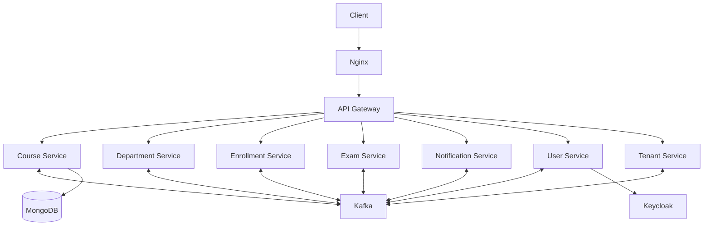

# Learning Management System API

A microservices-based learning management system prototype built with Node.js services and containerized infrastructure.

## Architecture

The repository is organized around an API gateway and domain services for courses, departments, enrollments, exams, notifications, users, and tenants. The local infrastructure includes Kafka, Zookeeper, Keycloak, MongoDB, PostgreSQL, Kafka UI, and Nginx.

## Main technologies

- Node.js and TypeScript
- Express
- Kafka and Zookeeper
- Keycloak and JWT/JWKS
- MongoDB and PostgreSQL
- Docker Compose and Nginx

## Local development

1. Install Docker Engine and the Docker Compose plugin.
2. Copy `.env.example` to `.env`.
3. Replace every placeholder with local development credentials.
4. Start the stack with `docker compose up --build`.
5. Check container logs and health checks before using the API.

Do not commit `.env` files or reuse development credentials in a deployed environment.

## Project status

This repository is an educational prototype, not a production-ready LMS. Service configuration, authorization boundaries, database migrations, observability, automated tests, and deployment hardening require further validation.
